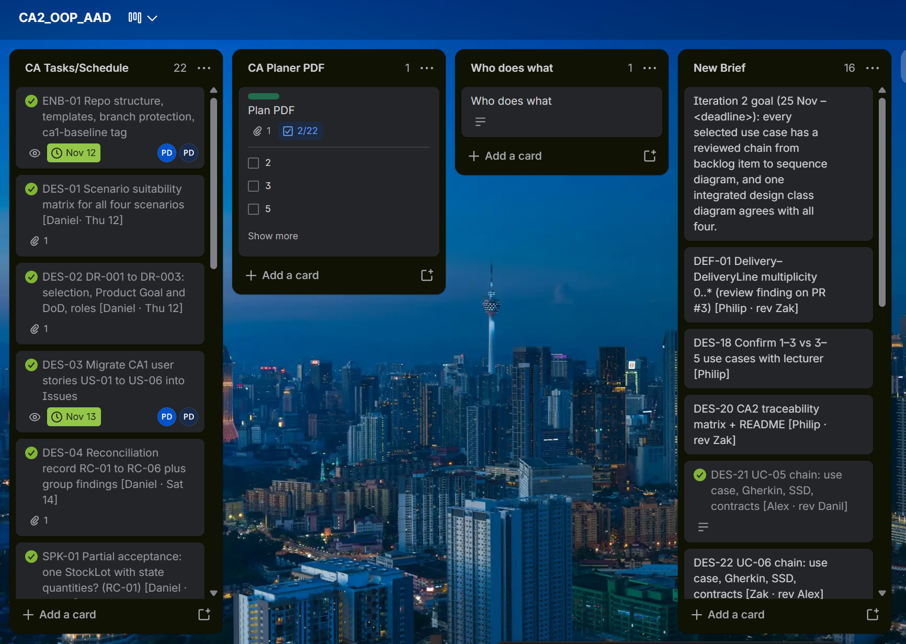

# CA2 Design Dossier – Kerry Local Food Hub

**Module:** Object-Oriented Analysis and Design · **Group:** MTUCA2Group
**Members:** Philip Dawson-Gariepy, Danil Kramnov, Oleksandr Motoryhin, Zakary Snyder
**Repository:** https://github.com/MTUCA2Group/ca-analysis (tag `ca2-submission`)

The repository is the authoritative record. Every artefact named here links to its editable source; diagrams are exported beside their `.puml` files.

---

## 1. Introduction and Product Goal

Kerry Local Food Hub collects produce from local producers and allocates it to household, hospitality and community customers. Its core problem is that goods received are not the same as goods available: some fail checking, some are held, and allocations are made from stock that may not exist. CA2 designs the part of a system that fixes this.

**Product Goal:** give Kerry Local Food Hub staff and volunteers one reliable record of what has arrived, what is held and what is available, so that customers receive only checked goods, shortfalls follow customers' stated preferences, and every allocated item can be traced to its producer and batch ([DR-002](../decisions/DR-002-product-goal-and-dod.md)).

We designed four use cases in detail: UC-02 Receive delivery, UC-03 Release held stock, UC-05 Allocate stock and UC-06 Handle shortfall. Each follows one chain: backlog item → use case and Gherkin → system sequence diagram → operation contract → CRC and GRASP → sequence diagram → integrated design class diagram.

---

## 2. Scenario Selection and Agreed Baseline

Each member presented their CA1 scenario, and the group compared all four on the brief's criteria: manageable scope, behavioural richness, object-oriented design potential and suitability for use-case and interaction design ([DR-001](../decisions/DR-001-scenario-selection.md)).

| Criterion | 07 Energy Advice | **19 Local Food Hub** | 27 Outdoor Equipment | 32 Property Maintenance |
|---|---|---|---|---|
| Manageable scope | High | **High** | Medium | Low |
| Behavioural richness | Medium | **High** | High | High |
| OO design potential | Medium | **High** | High | Medium |
| Use-case and interaction design | Medium | **High** | Medium | Medium |

We selected **Scenario 19**. Its core problem, "received does not mean available", gives clear state changes (accepted, held, released, written off, allocated) with testable rules (BR-01, NFR-04). Outdoor Equipment was rejected because its eligibility and restriction rules were unconfirmed; Property Maintenance because its scope was too large and its status meanings undefined; Energy Advice because it had too little state change. The lecturer approved the selection; no expansion items were given.

**Reconciliation.** CA1 was not adopted unchanged. The [reconciliation record](../decisions/reconciliation-record.md) lists seven changes made against tag `ca1-baseline`, each through a reviewed change:

| ID | Change | Why |
|----|--------|-----|
| RC-01 | `StockLot` gains `heldQuantity`; every received line yields a lot unless rejected | A held remainder had nowhere to live ([SPK-01](../decisions/SPK-01-partial-acceptance.md)) |
| RC-02 | Shortage priority sits behind `AllocationPolicy` | Priority rules unconfirmed (Q-05); still open after [SPK-02](../decisions/SPK-02-allocation-policy.md) |
| RC-03 | The manager may reject during receipt | Avoids holding goods only to reject them later |
| RC-04 | `QualityCheck` belongs to `StockLot` and records released and rejected quantities | A check can release part and reject part |
| RC-05 | Returned perishables can never return to stock | CA1 contradicted A-08 |
| RC-06 | Staff or manager release held stock; only the manager rejects | Volunteers record arrival; staff complete checks |
| RC-07 | Abandoning a receipt keeps recorded outcomes | Avoids hiding goods already accepted |

The spike SPK-01 was the most significant baseline decision: one `StockLot` holding accepted, held and written-off quantities was chosen over a separate held-goods object, because one lot keeps one producer and batch (BR-03).

Everything not listed in the reconciliation record was accepted from CA1 unchanged: the stakeholder catalogue, functional and non-functional requirements, business rules BR-01 to BR-05 and the use-case catalogue. CA1 files were not copied into CA2; they stay under `report/` and `diagrams/`, and only the domain model was edited, through the same reviewed changes that introduced RC-01, RC-04 and RC-05. This kept the baseline small: each change has an identifier, a reason and a list of affected artefacts, so any design decision that depends on it can be traced back to the record rather than to a rewritten CA1.

---

## 3. Selected Design Scope

We selected four use cases because together they cover the Product Goal end to end: goods arrive and are checked (UC-02), held goods are released or written off (UC-03), checked goods are allocated with traceability (UC-05), and shortfalls follow customers' preferences (UC-06).

| Use case | Owner | User value | Requirements / rules | Depends on | Why selected |
|----------|-------|------------|----------------------|------------|--------------|
| UC-02 Receive delivery (+ UC-11) | Philip | US-01, US-02 | FR-02 to FR-06 · BR-01, BR-03 · A-02, A-03, A-04 · NFR-04, NFR-05 | — | Root cause of the problem (E-02, E-04); four outcomes, a permission rule, unit conversion and traceability |
| UC-03 Release held stock | Danil | US-02 | FR-06 · BR-01, BR-03 · A-04, A-08 · NFR-04, NFR-05 | Lots with held quantity | Completes the held → available / written-off lifecycle; two permission rules |
| UC-05 Allocate stock (+ UC-09 Trace item) | Alex | US-05 | FR-07, FR-09, FR-12 · BR-01, BR-03 · NFR-04 | Available lots | Keeps the producer and batch link when stock is split (E-07); must never over-allocate |
| UC-06 Handle shortfall | Zak | US-03, US-04 | FR-08, FR-10 · BR-05 · NFR-04, NFR-05 | Lines left short by UC-05 | Customers only receive substitutes they accept (E-05) and hospitality customers are warned early (E-06) |

UC-06 was briefly descoped (DR-011) and restored when its work arrived on 27 Nov, after being corrected for consistency with the other three ([DR-012](../decisions/DR-012-scope-restored-four-use-cases.md)).

**Not selected.** UC-01 is simple data entry, UC-07 depends on unresolved reopen rules (Q-11), UC-08 overlaps UC-03's write-off, and UC-10 only reads data.

---

## 4. Behavioural Design

All operations return `Result<T>`: a refusal is `Failure(code)` and changes nothing ([interface catalogue](../design/interface-catalogue.md) §2–3).

### 4.1 UC-02 Receive delivery

The [use case](../analysis/use-cases/UC-02-receive-delivery.md) has eleven extensions, including partial acceptance, holding, a volunteer refused when rejecting (A-04), a manager rejecting, a missing batch (A-03) and an unannounced delivery. Nine [Gherkin scenarios](../features/receive_delivery.feature) (GH-01, GH-02, GH-06 to GH-12) cover success, refusal and the accepted-quantity boundary, and map to US-01's acceptance criteria.

The scenarios use concrete values so the rules cannot be read two ways. GH-01 records 20 kg expected, 18 kg received and 15 kg accepted, and checks that exactly 3 kg is held. GH-09 is a scenario outline on the boundary of NFR-04: accepting 18 of 18 kg succeeds, 18.5 kg and 0 kg are refused with `INVALID_QUANTITY`. GH-12 shows the supplied unit being converted (5 boxes of 12 eggs become 60 each), and GH-10 shows a delivery accepted with its batch marked missing, so receipt is never blocked by a producer's incomplete records (A-03).

The [SSD](../design/ssd/SSD-S1-receive-delivery.puml) shows four system events: `startReceipt`, `addLine`, `recordLineReceipt` and `completeReceipt`. `recordLineReceipt` carries the richest behaviour, so its contract ([OC-03](../design/contracts/OC-S1-receive-delivery.md)) has five controlled failures. The most important is `NOT_PERMITTED` when a volunteer records *Rejected*. Its postconditions create a stock lot whose held quantity is never available, enforcing BR-01 at the moment goods enter the system. Abandoning a receipt is deliberately not a system event: recorded lines keep their outcomes (RC-07).

### 4.2 UC-03 Release held stock

The [use case](../analysis/use-cases/UC-03-release-held-stock.md) lets a staff member release held goods and the manager reject them. Its extensions refuse a volunteer (RC-06), refuse a non-manager who rejects (A-04), refuse a lot with nothing held, and refuse quantities that exceed what is held. [GH-13 to GH-17](../features/release_held_stock.feature) cover full release, part release with rejection, both permission refusals and the released-quantity boundary.

The [SSD](../design/ssd/SSD-S2-release-held-stock.puml) has two events. `listHeldLots` only reads data, so it has no contract. `recordQualityCheck` changes state, so [OC-05](../design/contracts/OC-S2-release-held-stock.md) specifies it: a `QualityCheck` is created and linked to the lot and user; held quantity decreases by released plus rejected; accepted increases by released; written-off increases by rejected. The lot's trace details never change, so released goods keep their producer and batch.

The use case's minimal guarantee, "nothing changes unless the whole check is valid", shaped the contract: OC-05 has one success path and four controlled failures, and none of them create a `QualityCheck` or move any quantity. GH-14 is the richest example: the manager releases 7 kg and rejects 30 kg of a 37 kg hold, leaving 20 kg available, nothing held and 30 kg written off.

### 4.3 UC-05 Allocate stock

The [use case](../analysis/use-cases/UC-05-allocate-stock.md) allocates checked stock to an order line. Volunteers are refused; a fully allocated line is refused; held stock is never counted (BR-01); lots without a use-by date are used last. [GH-18 to GH-22](../features/allocate_stock.feature) cover allocation from one and several lots, the shortfall case and the never-over-allocate boundary, and [GH-05](../features/trace_item.feature) covers tracing.

The [SSD](../design/ssd/SSD-S3-allocate-stock.puml) has three events; only `allocateOrderLine` changes state ([OC-06](../design/contracts/OC-S3-allocate-stock.md)). Lots are taken earliest use-by first; for each lot used an `Allocation` is created, linked to the line and the lot, and the lot's allocated quantity grows by exactly what it gives. A shortfall is a success, not a failure: the remaining quantity is returned as the line's shortfall. The invariant `allocatedQuantity ≤ acceptedQuantity` holds for every lot (NFR-04).

Treating a shortfall as a success was a deliberate behavioural choice. UC-05 allocates everything available and reports what is missing; deciding what to do about the missing quantity belongs to UC-06, so neither use case has to know the other's rules.

### 4.4 UC-06 Handle shortfall

The [use case](../analysis/use-cases/UC-06-handle-shortfall.md) lets a staff member resolve a short line in one of four ways (substitute, reduce, remove or contact the customer), but only as the customer's recorded preferences allow (BR-05, FR-08). Contacting the customer is always permitted, so a line with no preferences can still be resolved. [GH-23 to GH-28](../features/handle_shortfall.feature) cover a permitted substitute, a substitute with no stock, a substitute that is not permitted, the never-over-allocate boundary, a hospitality customer flagged for contact, and a volunteer refused.

The [SSD](../design/ssd/SSD-S4-handle-shortfall.puml) has two events; only `resolveShortfall` changes state ([OC-07](../design/contracts/OC-S4-handle-shortfall.md)). Its postconditions differ by resolution: a substitute creates allocations from the substitute product's lots and increases each lot's allocated quantity; reduce and remove create nothing and close the shortfall; every resolution records who and when. If a hospitality customer's line stays short, or the customer must be contacted, the order is flagged for contact before delivery (FR-10). As in UC-05, a substitute with too little stock is a success that leaves a remaining shortfall.

---

## 5. Responsibilities: CRC and GRASP

Five GRASP decision records cover the design: [DR-005](../decisions/DR-005-receive-delivery-controller.md), [DR-006](../decisions/DR-006-stock-lot-creator.md), [DR-007](../decisions/DR-007-release-held-stock-responsibilities.md), [DR-008](../decisions/DR-008-shortfall-responsibilities.md) and [DR-010](../decisions/DR-010-allocation-responsibilities.md). Each records candidates, the decision, the principle, a rejected alternative and consequences.

### 5.1 UC-02 Receive delivery

The [CRC cards](../design/crc/CRC-S1-receive-delivery.md) place every rule with the class that holds its data. `ReceiveDeliveryHandler` is a use-case controller (DR-005): it receives the four system events and coordinates, but makes no decisions. A single `HubController` was rejected because it would grow with every use case. `DeliveryLine` holds received and accepted quantities, so it checks that accepted never exceeds received (Information Expert) and creates the `StockLot` (Creator, DR-006); letting the handler create the lot was rejected because the "no lot when rejected" rule would sit outside the domain. `Delivery`, as aggregate root, completes the trace details because only it knows the producer and date. `ReceiptOutcome.permittedFor(role)` holds the rejection rule, so a change to A-04 touches one method (Protected Variations).

Two smaller placements support the same goal. `ReceiptOutcome.createsLot()` keeps the rule "a rejected line yields no lot" with the outcome it depends on, and `Product.toSellingUnit()` keeps conversion factors with the product (A-02). If the hub answers Q-02 with a richer conversion policy, only `Product` changes.

### 5.2 UC-03 Release held stock

The [CRC cards](../design/crc/CRC-S2-release-held-stock.md) give the quality check to `StockLot`, not to the controller (DR-007). The lot owns all three quantities, so it moves released goods from held to accepted and rejected goods from held to written off (Information Expert), and it creates the `QualityCheck` because it records its checks and holds the data to validate them (Creator). Permissions sit in `Role.mayRelease()` and `mayReject()`, so if the hub's answer to Q-04 or Q-07 differs, only `Role` changes (Protected Variations). The rejected alternative, a controller checking roles with `if` statements and setting quantities through setters, would let any caller bypass NFR-04. Quality checks are saved with their lot, avoiding a second repository whose saves could disagree.

`QualityCheck` validates itself (no negative quantities, not both zero, a reason whenever anything is rejected), so the lot only has to check the quantities against what it holds. This keeps each class's checks about its own data.

### 5.3 UC-05 Allocate stock

The [CRC cards](../design/crc/CRC-S3-allocate-stock.md) split allocation between two experts (DR-010). `OrderLine` knows the requested quantity and its existing allocations, so it knows what is outstanding and creates each `Allocation` (Creator; the domain model records allocations against the line). `StockLot` alone knows its available quantity, so `StockLot.allocate` refuses anything above it, and `expiresBefore` holds the use-by ordering rule. Two alternatives were rejected: the controller creating allocations, which would put rules in the controller, and a repository returning lots already sorted, which would put a hub rule into storage.

The split also protects the other use cases: `StockLot` does not depend on orders, so UC-02 and UC-03 carry no dependency on UC-05. If the hub later changes the order in which lots are used, only `StockLot.expiresBefore` changes.

### 5.4 UC-06 Handle shortfall

The [CRC cards](../design/crc/CRC-S4-handle-shortfall.md) put the customer's preferences on `OrderLine`, where the CA1 domain model already placed them, so the line checks whether a resolution is permitted and applies it (Information Expert, DR-008). For a substitute, it creates the allocations exactly as in UC-05 (Creator), reusing `StockLot.allocate`, so NFR-04 is enforced in one place for both use cases. `Order` decides whether the customer must be contacted, because only the order knows its customer's type. Three alternatives were rejected: the controller checking preferences, which would put BR-05 outside the domain; one strategy class per resolution type, which four short branches do not justify; and an `AllocationPolicy` class, which SPK-02 found has no caller in the designed operations.

**Integrated design class diagram.** The [integrated diagram](../design/DCD-integrated.puml) merges the four use-case fragments. It shows five controllers (one per use case, plus `TraceItemHandler` for UC-09), three aggregates (`Delivery`, `StockLot`, `Order`) and the shared ports. Every operation in it is either an SSD system operation or a message in a sequence diagram.

---

## 6. Object Interactions and Consistency

Each sequence diagram's first message is the system event from its SSD, and every later message maps to an operation in the integrated diagram. The message-to-operation tables are in the [traceability matrix](../analysis/traceability-ca2.md).

### 6.1 UC-02 Receive delivery

[SD-S1a](../design/sequence/SD-S1-record-line-receipt.puml) realises OC-03. The handler delegates to `Delivery.recordLine`, which completes the trace and passes the receipt to the line; the line checks permission, converts units, validates quantities and creates the lot. Saves happen only after the last check, so every refusal leaves the system unchanged. [SD-S1b](../design/sequence/SD-S1-complete-receipt.puml) and [SD-S1c](../design/sequence/SD-S1-start-receipt.puml) realise OC-04 and OC-01/OC-02, including creation of an unannounced delivery and its lines.

The handler never calls a `DeliveryLine` directly: every line operation goes through `Delivery`, so a second caller cannot record a line on a completed receipt. The only object the handler creates is the result it returns; `Delivery`, `DeliveryLine` and `StockLot` are each created by the class that holds their initialising data.

### 6.2 UC-03 Release held stock

[SD-S2](../design/sequence/SD-S2-release-held-stock.puml) realises OC-05. The handler reads the user, role and time, loads the lot, and calls `StockLot.recordCheck`. The lot asks `Role` whether the actor may release or reject, validates quantities against what is held, creates the `QualityCheck` and moves its quantities. The handler saves the lot only on success and returns the new available, held and written-off quantities.

The read-only `listHeldLots` event is also sequenced: the lot describes itself as a `HeldLotView`, so the handler never reads the lot's quantities field by field.

### 6.3 UC-05 Allocate stock

[SD-S3a](../design/sequence/SD-S3-allocate-order-line.puml) realises OC-06. The handler checks the role, loads the order and the available lots, and calls `Order.allocateLine`, which delegates to the line. The line sorts lots with `expiresBefore`, asks each for `availableQuantity()`, calls `allocate` for the smaller of outstanding and available, and creates one `Allocation` per lot used. [SD-S3b](../design/sequence/SD-S3-trace-order-line.puml) realises the UC-09 trace by reading each allocation's trace entry.

The handler saves the order and every lot it changed in one place, after the line returns success, so a lot's allocated quantity and the allocations that explain it can never disagree.

### 6.4 UC-06 Handle shortfall

[SD-S4](../design/sequence/SD-S4-handle-shortfall.puml) realises OC-07. The handler checks the role and loads the order; only for a substitute does it load lots, and only for the substitute product. `Order.resolveShortfall` routes to `OrderLine.resolve`, which checks that something is outstanding, checks the resolution against the preferences, allocates substitute stock with the same `StockLot` calls as UC-05, and records the resolution. The order then decides whether contact is required and builds the result. As in every other use case, saves happen only after success.

### 6.5 Consistency across the four use cases

`StockLot` is the one class all four use cases touch: UC-02 creates it, UC-03 moves held quantity, UC-05 and UC-06 allocate from it. The fragments first disagreed on its attribute names and on the available-quantity formula; merging them into the integrated diagram exposed both, and we fixed them in one reviewed change (DEF-02): `availableQuantity() = acceptedQuantity − allocatedQuantity`. Merging UC-06 exposed a second set of disagreements (three signatures for one system event, a contract that increased stock on allocation), which were corrected before it was included (DR-012). A final check confirmed that every message in all seven sequence diagrams maps to an operation in the integrated diagram, and every operation there is used.

---

## 7. Design Structure and Shared Interfaces

The [package view](../design/package-view.puml) has three layers. Presentation is out of scope. Each use case is a package (`receiving`, `stockdecisions`, `allocation`, `shortfall`) holding its controller and slice-only classes. All four depend on `shared`, which holds the shared domain classes, ports and result types, and never on each other, so a change in one use case cannot break another.

The [interface catalogue](../design/interface-catalogue.md) fixes the shared vocabulary:

- **Result convention:** every operation that can be refused returns `Result<T>`; a failure changes nothing, and controllers save only on success.
- **Error codes:** `NOT_FOUND`, `NOT_PERMITTED`, `INVALID_QUANTITY`, `INVALID_STATE`, `INVALID_TRACE`. A use case may not invent its own.
- **Roles:** `VOLUNTEER` ⊂ `STAFF` ⊂ `MANAGER`, read from `AuditContext`, never passed by the actor.
- **Ports:** one repository per aggregate root (`DeliveryRepository`, `StockLotRepository`, `OrderRepository`), plus `ProducerRepository`, `ProductRepository`, `AuditContext` and `Clock`. Ports are called by controllers, not domain classes.
- **StockLot rules:** which use case changes which quantity, and the availability invariant.

A port used by only one use case stays in that use case's package (`DeliveryRepository` and `ProducerRepository` in `receiving`); ports used by more than one, such as `StockLotRepository` and `OrderRepository`, sit in `shared`. Every `find` operation returns `Optional`, and the controller turns an empty result into `NOT_FOUND`, so domain classes never deal with missing records.

---

## 8. Design Evaluation

**Cohesion.** Each use case has its own controller (`ReceiveDeliveryHandler`, `ReleaseHeldStockHandler`, `AllocateStockHandler`, `HandleShortfallHandler`, plus `TraceItemHandler`) rather than one hub facade (DR-005). Controllers only coordinate; rules sit with the objects that hold the data: `DeliveryLine` checks accepted against received, `StockLot` guards held versus available and records quality checks (DR-007), and `OrderLine` allocates from lots (DR-010) and applies shortfall resolutions (DR-008). The cost is repetition: every controller reads the user, role and time before delegating.

**Coupling.** Controllers depend on repository interfaces, never on storage, and use-case packages depend only on `shared`. The strongest coupling is around `StockLot`: all four use cases use it, so a change to its quantities affects every slice. We accepted this because one lot per received line keeps one producer and batch (SPK-01); splitting it would have spread traceability across objects. `OrderLine` is the second hotspot: UC-05 and UC-06 both add behaviour to it, which keeps allocation rules together but makes it the largest domain class.

**Object validity.** Objects are created valid or not at all: `Delivery.startUnannounced` sets the unannounced invariants, `StockLot` is constructed with its quantities, and every operation returns `Result<T>`, so a refusal changes nothing. No class exposes a public status or quantity setter.

**Result instead of exceptions.** We considered signalling business refusals with exceptions. We chose `Result<T>` because a refusal is an expected outcome the actor must see, not a fault, and because every refusal in the contracts is then visible in the sequence diagrams as a returned `Failure`, which made the contract-to-interaction check possible. Exceptions remain for technical faults, which are outside the CA2 design.

**The availability formula.** Two versions of `availableQuantity()` existed until the class diagrams were merged. Subtracting written-off quantity from accepted quantity would double-count it, because written-off goods leave the held quantity, not the accepted quantity. We kept `acceptedQuantity − allocatedQuantity` and recorded the fix as DEF-02.

**Main risk found in evaluation.** The manager-only rejection rule (A-04) is phrased twice: `ReceiptOutcome.permittedFor(role)` at receipt and `Role.mayReject()` in the quality check. Both rely on `Role`, but if Q-04 changes, both must change. The first refactoring we would make is for `permittedFor` to delegate to `Role.mayReject()`.

**Assumptions.** A-02 fixed unit conversion per product; A-04 only the manager rejects; RC-05 perishables never return to stock; lots are allocated earliest use-by first; A-12 a substitute counts one-for-one in the same selling unit; A-13 volunteers may not allocate or resolve shortfalls.

**Rejected alternatives.** A single `HubController` (DR-005); a separate held-goods object (SPK-01 option B); the controller creating stock lots (DR-006); the controller checking roles and setting quantities (DR-007); a repository returning lots pre-sorted by use-by date (DR-010); one strategy class per shortfall resolution and an `AllocationPolicy` with no caller (DR-008, SPK-02).

**Limitations.** Priority between orders competing for the same stock (RC-02) is not designed; stock goes to orders in the order staff allocate them. The contact flag is recorded but sending the message is out of scope. The design does not cover concurrent recording of the same line, a database design, or UC-01, UC-07, UC-08 and UC-10. A partial release leaves one lot with mixed history, kept only in its quality-check records.

---

## 9. Process and Review Evidence

**Backlog and board.** The Product Backlog and iteration goals are on the Trello board (https://trello.com/invite/b/6ae8aa97f29ecaceb4239398/ATTI48b297c7096ae6107cb683c67108554f14AE61A7/ca2oopaad), with lists Backlog, Ready, In Progress, Peer Review, Blocked and Done. Cards use stable IDs (US, DES, SPK, DEF), name an owner and reviewer, and link to the pull request that completed them. Captures of the board are in the appendix.

**Repository.** Work was done on one branch per backlog item and merged through pull requests. Decisions were recorded as dated records (DR-001 to DR-012, SPK-01, SPK-02), and two defects found by checking the models against each other (DEF-01 multiplicity, DEF-02 availability formula) were fixed in separate changes.

**Iterations.** Iteration 1 agreed the scenario, Product Goal, roles and reconciled baseline. Iteration 2 produced the use-case chains, the interface catalogue and the integrated design. The updated brief on 25 Nov removed CA3, so the CA3 material was removed and recorded in DR-004. UC-06 was descoped on 26 Nov (DR-011) and restored on 27 Nov when its work arrived (DR-012).

**Review.** Pull requests were merged by their authors without a recorded GitHub review; the group did not enforce approvals on `main`. Checking happened instead through cross-model consistency checks, which found DEF-01, DEF-02 and the UC-06 inconsistencies corrected in DR-012, and through decisions agreed by the group (DR-001 to DR-003, DR-011, DR-012). The [retrospective](../docs/reflection/retrospective.md) records the lack of recorded peer review as the main process weakness; requiring one approval on `main` is the improvement we would make.

---

## 10. AI Use and How It Was Checked

Members' AI use is declared in the [group AI declaration](../decisions/ai-declaration-group.md) and individual logs. It was used for templates, first drafts of design artefacts and dossier text, consistency checks between models and wording. It did not make scope or design decisions on its own: each significant AI-supported change is listed in [DR-009](../decisions/DR-009-ai-supported-design-changes.md) with how it was evaluated.

AI output was checked in three ways. First, against the brief and Session 14's design-ready audit, which found naming and sequence-diagram problems that were then fixed. Second, by independent evaluation: SPK-01 compared the one-lot design against an alternative before it was accepted. Third, by cross-model consistency checks between sequence diagrams, contracts and the integrated class diagram. Changed or rejected suggestions are recorded in DR-009 and the individual logs.

---

## Appendices

- A. [CA2 traceability matrix and consistency evidence](../analysis/traceability-ca2.md)
- B. Decision records: `decisions/`
- C. Board captures: 
- D. Individual contribution statements and AI declarations: submitted separately by each member
- E. Diagrams (exports of the PlantUML sources)